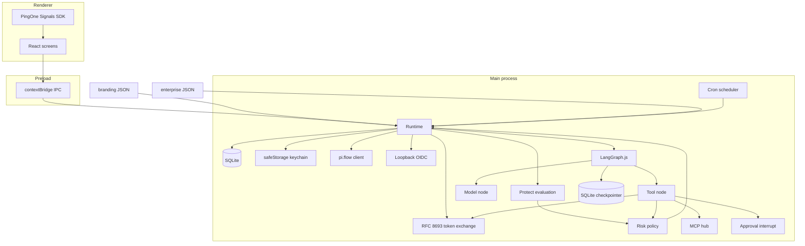

# Enterprise agent client

A white-label desktop AI agent. The product name, agent name, logo, colors, and default persona all come from a branding file. Nothing in the application source assumes a particular brand.

The sample theme in `branding/default.json` names the app and the agent **Pingy**. That name is an example only. Replace the branding file to ship the client under another name.

## What this repository contains

This is the foundation: a runnable Electron app with PingOne sign-in (including a mock mode), token exchange, PingOne Protect risk policy, an MCP client with tool approvals, single-agent chat, and the data model plus screens for instruction layers, group rooms, routines, cron, per-agent skills, and a group-gated Policy tab for PingOne Authorize. Later work is listed under [Follow-up issues](#follow-up-issues).

## Stack

| Piece | Choice |
| --- | --- |
| Shell | Electron 44, React 19, TypeScript, Vite via electron-vite |
| MCP | `@modelcontextprotocol/client` 2.x (stdio, Streamable HTTP, SSE fallback, MCP OAuth) |
| Agent runtime | LangGraph.js in the Electron main process. No Python runtime. |
| Models | LangChain chat models for OpenAI (including GPT-5 reasoning), Anthropic (extended thinking), the generic HTTP provider, and mock mode |
| Local data | `node:sqlite` (`DatabaseSync`) in the user-data directory, including the LangGraph thread checkpointer |
| Secrets | Electron `safeStorage` (macOS Keychain, Windows DPAPI, Linux libsecret). Encrypted blobs sit in SQLite. If encryption is unavailable, secrets stay in memory for that process and are not written to disk. |
| Platforms | The same code path targets macOS, Windows, and Linux. CI runs on Linux. Installers and code signing are not in this version. |

Alternatives considered:

- **Electron rather than Tauri.** The official MCP client and `safeStorage` are Node APIs. A Tauri shell would mean a second MCP stack and a separate keychain crate.
- **`node:sqlite` rather than `better-sqlite3`.** Node 22 includes `DatabaseSync`, so the app does not need a native rebuild per Electron ABI. The module is still marked experimental by Node.
- **`safeStorage` rather than `keytar`.** `keytar` is unmaintained. `safeStorage` is the Electron-supported OS keychain.
- **MCP client package v2 rather than `@modelcontextprotocol/sdk` v1.** v2 is the current client line. The sample stdio server speaks the legacy `initialize` handshake, which is the client's default.

## Architecture



A turn is one LangGraph. The model node calls a LangChain chat model and streams tokens, reasoning, and phase changes. The tool node is the only place a tool can run: it applies the Protect action (block, read-only, restrict, or the remembered choice), pauses with `interrupt` for allow once / always / deny, and only then obtains a token and passes it into the MCP call. An HTTP extension with an audience in `enterprise.json` still uses token exchange (user subject plus agent actor). The PingOne MCP server, whose id matches `authorize.mcpServerId`, uses the worker client-credentials token instead, and the tool node denies it unless the signed-in user is in the admin group, Authorize allows PingOne tools, and that agent has the PingOne skill. HTTP extensions with no audience use MCP authorization (protected resource metadata, authorization-server metadata, dynamic client registration or a client ID metadata document, then authorization code with PKCE). Enterprise, persona, user, room, risk, and assigned skill instructions are fields on the graph state. The model node composes them, with the locked enterprise layer first. Group rooms are the same graph with a turn-taking step across each member, and each member keeps its own instructions. Routines and cron start that graph. Threads are checkpointed in SQLite (`langgraph.sqlite` next to attachments) so an approval can resume on a new graph instance. The checkpointer uses `node:sqlite` rather than `better-sqlite3`, which does not load in Electron.

Sign-in, in order:

1. The login screen collects a username and password and, in real PingOne mode, Protect Signals data.
2. Preferred login is redirectionless **pi.flow** (`response_mode=pi.flow`) with authorization code and PKCE (S256). The system browser plus a `127.0.0.1` loopback redirect is a configurable fallback.
3. Protect runs a risk evaluation before the session is stored. Policy maps the level and reason codes to one action: allow, step-up MFA, restrict tools, read-only, or block. The most restrictive matching action wins. After sign-in, Protect is polled again on `protect.pollIntervalSeconds` (default 30; `0` turns polling off). Each result updates the risk indicator, the Protect action on the next turn, and the Authorize decision when the level changes.
4. A blocked result never stores a session. Step-up restarts the flow with `acr_values` when that value is configured. Mock mode accepts any 6-digit one-time code for the new-device scenario.
5. The user token is stored in the keychain. If a refresh token exists, expiry refreshes it. Otherwise the user signs in again.
6. The AI Agent application mints its own access token with client credentials. That token is cached until it expires. Each configured audience is then exchanged (RFC 8693) on the same AI Agent client: the user's access token is the `subject_token`, and the agent token is the `actor_token`. Exchange runs only for an MCP server that has an audience. HTTP and SSE receive that token through the client auth provider, and stdio receives it as `MCP_ACCESS_TOKEN`. An HTTP extension with no audience does not exchange a token; its card stays on Needs sign-in until MCP authorization completes.

The agent is risk-aware. The composed system prompt is enterprise policy, then persona, then the user layer, then optional room instructions, then the current risk context (level, reasons, and the behaviour the policy requires).

## Setup

Requirements: Node.js 22.13 or newer.

```bash
npm install
npm run dev
```

Mock mode is the committed example, so `npm run dev` signs in locally and does not call PingOne. Any non-empty password is accepted. On the login screen, choose a risk scenario: low, new device, anomalous location, impossible travel, or bot.

### If dev reports "Electron uninstall"

Electron 44's npm package does not download the desktop binary from a `postinstall` script. `electron-vite` then reads `node_modules/electron/path.txt` and throws `Error: Electron uninstall` when that file was never written. A fresh `npm install` on macOS (and on Windows or Linux) hits this before the window opens. The message means the desktop binary was never downloaded.

`postinstall`, `predev`, and the `dev` script itself run `scripts/ensure-electron.mjs`. When the binary for the current OS is missing, that script runs `node node_modules/electron/install.js`, which writes `path.txt` (`Electron.app/Contents/MacOS/Electron` on macOS, `electron.exe` on Windows, `electron` on Linux). `npm install && npm run dev` therefore downloads Electron before `electron-vite` starts.

`npm install --ignore-scripts`, or `ignore-scripts=true` in your npm config, skips `postinstall` and `predev`. The `dev` script still runs the check, because npm executes the script you named even when it skips lifecycle hooks. If you start `electron-vite` directly, run the installer yourself:

```bash
node node_modules/electron/install.js
npm run dev
```

The zip comes from the Electron GitHub releases. Behind a proxy, set `ELECTRON_MIRROR` to a mirror of those releases. `ELECTRON_SKIP_BINARY_DOWNLOAD=1` skips the check on purpose; unset it and run the installer above when you want the app to launch.

To point the app at a real tenant, copy the example config and env file. Do not commit either copy.

```bash
cp config/enterprise.example.json config/enterprise.json
cp .env.example .env
```

In `config/enterprise.json` set `tenant.mode` to `pingone` and fill the hosts, environment id, and public client id. Protect and token exchange use different confidential applications:

| Purpose | Client id | Secret |
| --- | --- | --- |
| PingOne Protect | `PINGONE_WORKER_CLIENT_ID` | `PINGONE_WORKER_CLIENT_SECRET` |
| RFC 8693 token exchange | `tokenExchange.clientId` | `PINGONE_AGENT_CLIENT_SECRET` |

Both secrets are copied into the OS keychain on launch when that account is empty (`workerClientSecret` and `agentClientSecret`). Settings can store either secret as well. If `tokenExchange.clientId` or `PINGONE_AGENT_CLIENT_SECRET` is unset, token exchange falls back to the worker id and secret, so a deployment that still uses one confidential application keeps working. When both are set, exchange uses the AI Agent application and Protect stays on the worker. Config parsing rejects secret-looking keys so a client secret cannot be committed inside JSON.

`BRANDING_PATH` overrides the branding file. `ENTERPRISE_CONFIG` overrides the enterprise file. The defaults are `branding/default.json` and, when present, `config/enterprise.json`, otherwise the example.

In a container where Chromium's sandbox cannot start, launch with both variables. `ELECTRON_DISABLE_SANDBOX` is read before the process starts; `AGENT_DISABLE_SANDBOX` also turns off GPU acceleration and `/dev/shm` usage.

```bash
ELECTRON_DISABLE_SANDBOX=1 AGENT_DISABLE_SANDBOX=1 npm run dev
```

Do not use those switches on a desktop you do not control. The sandboxed preload is built as CommonJS (`out/preload/index.cjs`) so it loads when `package.json` has `"type": "module"`.

### Scripts

| Script | Purpose |
| --- | --- |
| `npm run dev` | Vite dev server plus Electron |
| `npm run build` | Production bundle in `out/` |
| `npm run preview` | Run the production bundle |
| `npm run typecheck` | `tsc` for the main and renderer projects |
| `npm run lint` | ESLint |
| `npm test` | Vitest |

### Try the sample tools

1. Sign in with any username and a non-empty password. Leave the scenario on low.
2. Open **Tools**, connect **Local echo**. It runs `node examples/echo-mcp-server.mjs`.
3. In chat, send `echo hello`. Approve the tool call once. The transcript shows the tool card and the model's follow-up.
4. Sign out, choose **New device**, sign in again, and enter any 6-digit code. The session shows step-up. **Impossible travel** and **Bot** block sign-in.

## Branding

`branding/default.json`:

| Field | Role |
| --- | --- |
| `appName`, `agentName`, `tagline`, `about` | Required. The window title and login copy use these strings. |
| `logo` | SVG or image path next to the JSON file. Omitted logos fall back to a monogram of the app name. |
| `colors` | Required palette. Keys become CSS variables (`sidebarText` → `--sidebar-text`). |
| `persona` | Default instruction fields: `persona`, `communicationStyle`, `autonomy`, `safety`, `untrustedContent`. `{{appName}}` and `{{agentName}}` are filled when the prompt is composed. |

A missing `appName` throws. The app does not substitute a built-in name.

## Enterprise config

`config/enterprise.example.json` holds the tenant, token-exchange audiences, Protect policy, access and Authorize settings, locked enterprise instructions, the starting agents, rooms, MCP servers, routines, and provider defaults. `mcpServers` accepts the existing `transport` / `command` / `url` / `audience` shape and a Goose-style shape (`type` of `stdio`, `streamable_http`, or legacy `sse`, plus `cmd`, `uri`, `headers`, `env_keys`, `timeout`, `enabled`, and `description`). An `envs` object of values is refused. Environment values from the add dialog are stored with `safeStorage` under `mcp-env:<id>:<NAME>` and are not written to `enterprise.json`. Audience and scope stay on the row when the dialog omits them, so a server that already exchanges a token keeps doing that. The Extensions screen does not ask for an audience. After the first run, agents, their instructions, their routines, and their skills are edited in the Agents view. The branding agent (the sample theme's `agentName`) is created on first launch. Existing global instruction layers and routines are moved onto that agent. Each agent page has Instructions, Routines, Cron, and Skills tabs. Skills can be written in the form or uploaded as `SKILL.md` or a zip that contains one. The built-in PingOne skill is admin-only. Enterprise policy stays read-only on every agent. Group rooms choose from the same agent list.

`access.adminGroup` defaults to `Administrator`. `access.groupsClaim` defaults to `groups`. `authorize.decisionEndpointId` is empty until a PingOne decision endpoint is ready. `authorize.cacheMs` defaults to 30000. `authorize.mcpServerId` defaults to `pingone`.

Risk actions, from least to most restrictive: `allow`, `step_up_mfa`, `restrict_tools`, `read_only`, `block`. A reason override replaces the level default when it is more restrictive. `restrict_tools` hides "always allow". `read_only` denies tools that are not marked `readOnlyHint`. `block` denies every tool and does not create a session. Step-up gates entry; after MFA the session stays active and step-up does not also restrict tools.

Provider keys (`OPENAI_API_KEY`, `ANTHROPIC_API_KEY`, `GENERIC_PROVIDER_API_KEY`) are read from the environment into the keychain if that account is empty. The settings screen never displays a stored key. Leaving the field blank keeps the stored value.

The chat provider in this version is the global settings choice. Per-agent provider values are stored and are not yet what `speak()` uses.

`provider.temperature` is optional. It is sent only when the config or the settings field contains a number. Leave it out to use the model default. Reasoning models (`gpt-5*` and the o-series, such as `o3` and `o4-mini`) never receive `temperature` or `top_p`. Those requests use `max_completion_tokens`. With `provider.showReasoning` on (the default), they also request `reasoning.summary` `auto` and send reasoning effort `medium` unless `provider.reasoningEffort` is set to `minimal`, `low`, `medium`, or `high`. If the API rejects an unsupported sampling parameter, the client retries that request once without it.

### GPT-5

Set the provider block and put the API key in the environment (it is copied into the OS keychain on launch when that account is empty) or paste it once in Settings:

```json
"provider": {
  "default": "openai",
  "openaiBaseUrl": "https://api.openai.com/v1",
  "openaiModel": "gpt-5",
  "anthropicBaseUrl": "https://api.anthropic.com",
  "anthropicModel": "claude-sonnet-4-5",
  "genericBaseUrl": "",
  "genericModel": "default",
  "reasoningEffort": "medium"
}
```

```bash
OPENAI_API_KEY=sk-...
```

Do not set `temperature` for `gpt-5`. The model only accepts the default value.

`provider.showReasoning` defaults to true. While a model is working, chat shows a Thinking panel: OpenAI reasoning summaries for `gpt-5` and the o-series (Responses API, falling back to chat-completions `reasoning_content`), Anthropic extended thinking, or the status “Thinking…” when the provider sends no reasoning. The panel collapses when the answer starts and keeps the elapsed time. Set `showReasoning` to false to hide the panel and skip those reasoning requests. Stop keeps the partial answer. Delete chat removes that conversation’s messages, attachments, and tool results. Delete history on a room clears only its messages.

## PingOne admin configuration

Use three applications in the same environment. The public PKCE application cannot be the confidential token-exchange client, and the Protect worker is a different application from the AI Agent that holds the Token Exchange grant.

### 1. Native or single-page application (interactive login)

| Setting | Value |
| --- | --- |
| Application type | Native (or SPA) |
| Grant types | Authorization Code |
| PKCE | Required, S256 |
| Token endpoint authentication | `NONE` |
| Redirect URI | `http://127.0.0.1:53147/callback` (must match `tenant.redirectUri`) |
| Scopes | `openid`, `profile`, `email` |
| Response modes | `pi.flow` for the in-app login, and `query` for the system-browser fallback |
| Sign-on policy | Username/password, or identifier first followed by a PingOne password. Add an MFA step if you want real step-up. External identity providers, FIDO2, and push still use the system browser. |

Put the environment id and this application's client id in `tenant`. Set `tenant.authHost` and `tenant.apiHost` for the region (`https://auth.pingone.com` and `https://api.pingone.com`, or the `.eu`, `.ca`, `.asia`, or `.com.au` hosts). `tenant.region` is a label for operators; the hosts are what the client calls.

`tenant.login.preferred`: `pi.flow` or `system-browser`. `allowSystemBrowserFallback` shows the browser button next to pi.flow. `stepUpAcrValues` is sent as `acr_values` when policy asks for step-up and the first flow did not challenge the user. If that second flow still has no MFA challenge, sign-in stops and the message tells an admin to fix the sign-on policy. A locally typed code is treated as MFA only in mock mode.

pi.flow actions are `POST`ed to the `_links` href for that action. When the status requires the action and the href did not parse, the client posts to `{authHost}/{envId}/flows/{flowId}`. It reads `status` and `_links` before choosing an action, and it does not post `usernamePassword.check` on an identifier step.

- `USERNAME_PASSWORD_REQUIRED` and `PASSWORD_REQUIRED` post `{ "username", "password" }` as `application/vnd.pingidentity.usernamePassword.check+json`.
- Identifier first (`SIGN_ON_REQUIRED`, or the same step when the status is `IDENTIFIER_REQUIRED`) posts `{ "username" }` as `application/vnd.pingidentity.user.lookup+json`. If the next status is `PASSWORD_REQUIRED` (or still offers `usernamePassword.check`), the password is posted with the username/password media type. If the next status is OTP, device selection, or an external provider, the password is not posted and that step is shown instead.
- `OTP_REQUIRED` posts `application/vnd.pingidentity.otp.check+json`.
- `DEVICE_SELECTION_REQUIRED` posts `application/vnd.pingidentity.device.select+json`.

`COMPLETED` (and `COMPLETED_ACCEPTED` when it carries a code) is read from `authorizeResponse.code` or from the resume URL. The code is exchanged at `{authHost}/{envId}/as/token` with `grant_type=authorization_code`, the PKCE verifier, and no client secret.

### 2. Worker application (Protect, Authorize, and the PingOne MCP server)

| Setting | Value |
| --- | --- |
| Application type | Worker |
| Grant types | Client Credentials |
| Token endpoint authentication | `CLIENT_SECRET_BASIC` |
| Roles | A custom role that can create and update risk evaluations. For Authorize and the PingOne MCP server, add the least-privilege roles that can read, create, and update authorization policies, read decision endpoints, and evaluate a decision (`authz:authorize:decisionendpoint`). Do not grant Environment Admin. |

Store the client id in `PINGONE_WORKER_CLIENT_ID` and the secret in `PINGONE_WORKER_CLIENT_SECRET` (or paste the secret in Settings). Client credentials mint the worker token used as the bearer on Protect, on PingOne Authorize policy and decision calls, and on the PingOne MCP server. Those calls do not use token exchange. The token request authenticates with HTTP Basic (`client_secret_basic`): `Authorization: Basic` plus a body of `grant_type=client_credentials` only. Putting `client_id` or `client_secret` in that body returns `Unsupported authentication method` on a worker app that requires Basic. This application does not need the Token Exchange grant. Sending its credentials to the token endpoint returns `Unsupported grant type`.

Other MCP servers exchange a token on the AI Agent application only when an audience is configured. Add the PingOne MCP server in Extensions with the id in `authorize.mcpServerId` (default `pingone`). Leave its audience empty so the app attaches the worker token. Do not put the worker secret in `enterprise.json`. HTTP extensions with no audience use MCP OAuth instead, and that flow has no fields on the add dialog.

### 3. AI Agent application (token exchange)

In the PingOne admin console, open **Applications → AI Agents** and register the desktop agent (the sample branding calls this app Pingy; the product name comes from your branding file).

| Setting | Value |
| --- | --- |
| Application type | AI Agent |
| Grant types | Token Exchange and Client Credentials |
| Token endpoint authentication | `CLIENT_SECRET_BASIC` |
| Resource grants | Each custom resource the desktop should call |

Put that application's client id in `tokenExchange.clientId`. Put the secret in `PINGONE_AGENT_CLIENT_SECRET`. The secret is stored in the keychain and is never written to the enterprise JSON. Every exchange uses this client. There is no switch to turn the actor token off.

```json
"tokenExchange": {
  "clientId": "<AI Agent application client id>",
  "inspectTokens": true,
  "audiences": []
}
```

```bash
PINGONE_WORKER_CLIENT_ID=<Protect worker client id>
PINGONE_WORKER_CLIENT_SECRET=<Protect worker secret>
PINGONE_AGENT_CLIENT_SECRET=<AI Agent application secret>
```

### 4. Custom resources (audiences)

For each MCP server or downstream API that should receive an exchanged token. Extensions added in the dialog do not need an audience; leave this section for servers that must keep token exchange:

- Create a custom resource. The audience URL must not contain `pingone` or `pingidentity`.
- Grant the **AI Agent** application that resource and the scopes the server expects. The Protect worker does not need these grants.
- Add an entry under `tokenExchange.audiences` with `audience`, `scope`, and the `serverId` of the MCP server that should receive the token.

The desktop always exchanges in three steps, once per configured audience for the last step:

1. `grant_type=client_credentials` on the AI Agent client (`tokenExchange.clientId` and `PINGONE_AGENT_CLIENT_SECRET`, Client Secret Basic). This is the agent's own access token. It is cached until `expires_in` and reused for every audience.
2. The signed-in user's access token, from the PKCE sign-in.
3. `grant_type=urn:ietf:params:oauth:grant-type:token-exchange` on that same AI Agent client. `subject_token` is the user access token and `actor_token` is the agent access token. Both `subject_token_type` and `actor_token_type` are `urn:ietf:params:oauth:token-type:access_token`, along with `requested_token_type` set to the same value, plus `audience` and `scope`.

The Protect worker is not the client on these calls. When the AI Agent client id or secret is unset, both the client-credentials call and the exchange fall back to the worker credentials. Exchanged tokens are cached in the keychain until shortly before `expires_in`.

### 5. The `act` claim

PingOne does not add `act` unless the custom resource maps it. Map it from the actor token. The user access token from SSO does not contain `may_act`, so an expression that copies `subjectToken.may_act` evaluates to null and the claim is omitted. That is why `act` was blank while another custom claim on the same resource was present.

On the custom resource that the exchange calls, map `sub` from the user token:

```
#root.context.requestData.subjectToken.sub
```

Map `act` from the AI Agent client-credentials token sent as `actor_token`:

```
{"sub": #root.context.requestData.actorToken.client_id}
```

Other custom claims use the same attribute screen. A claim mapped to a value that exists on the request, such as `#root.context.requestData.subjectToken.sub`, is included. Leave `act` optional unless the actor token is guaranteed; a required `act` mapping that evaluates to null fails the exchange.

Settings includes a **Tokens** inspector when `tokenExchange.inspectTokens` is true. If the flag is omitted, the inspector is on for mock mode and for an unpackaged dev launch, and off for a packaged PingOne build. Set it to `false` to hide the panel in an enterprise deployment. The panel lists the user access token, the AI Agent access token, and each exchanged audience token, with the decoded header and the `aud`, `scope`, `sub`, `act`, `may_act`, `exp`, and `iat` claims, plus time to expiry. **Refresh session token** replaces the user token. **Refresh agent token** mints a new client-credentials token. **Re-exchange now** discards one cached audience token and exchanges it again, reusing the agent token while it is still valid. The raw JWT stays hidden until **Reveal token**, and **Copy** is available only after that. Tokens are not written to logs.

### 6. Protect

| Setting | Value |
| --- | --- |
| Protect | Enabled on the environment |
| Risk policy | Include New Device, User Location Anomaly, Bot Detection, Anonymous Network, and IP Reputation |
| Impossible travel | Read from the evaluation details flag `impossibleTravel` |
| Worker role | A custom role that can create and update risk evaluations. Do not grant Environment Admin for this. |

The client `POST`s `{apiHost}/v1/environments/{envId}/riskEvaluations`. The event includes `ip`, `user.id`, `user.type` (`EXTERNAL` by default), and `sdk.signals.data` from the Signals SDK when the login mode is `pingone`. Mock mode does not load the SDK and does not call PingOne.

IP handling: the example config sets `protect.resolvePublicIp` to `true`. The main process calls `https://api.ipify.org` with a 2 second timeout, then `https://checkip.amazonaws.com` if that lookup fails. `protect.reportedIp`, when set, is sent instead and no lookup runs. If no address is available, the client still `POST`s the risk evaluation without `ip`. When PingOne accepts that event, its level is used. When PingOne rejects it, sign-in continues at level `UNKNOWN` and the action configured for that level. The example maps `UNKNOWN` to `restrict_tools`: the session is created, every tool call needs a fresh approval, and the system prompt tells the agent that Protect did not score the sign-in. A Protect error after an IP was sent still stops sign-in. After the session is allowed, the client `PUT`s the evaluation with `completionStatus` `SUCCESS`. A block or a failed sign-in sends `FAILED`.

Map levels and reason codes in `protect.policy`. Levels are `LOW`, `MEDIUM`, `HIGH`, and `UNKNOWN` (default `restrict_tools` when the key is omitted). Reason codes the policy understands: `NEW_DEVICE`, `ANOMALOUS_LOCATION`, `IMPOSSIBLE_TRAVEL`, `BOT`, `ANONYMOUS_NETWORK`. Unknown predictor output is still shown to the user and the agent.

The Signals SDK is loaded only for `tenant.mode: pingone`. The renderer content-security policy allows the regional PingOne app, auth, and API hosts plus `api.ipify.org`. Each poll asks the window for a fresh Signals payload and keeps the sign-in payload when the window cannot collect one.

`protect.pollIntervalSeconds` is how often a signed-in session is scored again. The default is 30. `0` scores only at sign-in. The process re-reads this value, and `protect.pauseWhenHidden`, from `enterprise.json` when the file changes, so an edit applies without a restart. Polls never overlap. A `429` with `REQUEST_LIMITED` keeps the last level and waits until both the interval and the `Retry-After` header have elapsed. Other transient failures (network errors and HTTP 5xx) also keep the last level. If Protect still cannot score the session, the `UNKNOWN` action applies, which is the existing fail-closed result. Polling stops on sign-out, quit, and access-token expiry. `protect.pauseWhenHidden` skips a poll while the window is hidden or the machine is suspended, and runs one when it becomes active again. Mock mode does not call PingOne: each poll, and a scenario change on the sign-in screen, re-applies the selected scenario so the indicator and the Authorize gates move with it. Keep the interval at 30 seconds or more. A shorter interval multiplies risk-evaluation calls by the number of signed-in clients and is what trips Protect `REQUEST_LIMITED`.

### 7. Groups claim and the Policy tab

Create a group whose name matches `access.adminGroup` (default `Administrator`) and add the people who may administer Authorize. Map that group membership into the signed-in user's access token under `access.groupsClaim` (default `groups`). The value can be a JSON array of names or a comma-separated string. If the access token omits the claim, the client reads the same claim from the ID token. Membership is an exact string match. The main process enforces it; hiding the Policy tab is not the only check.

In mock mode, the sign-in screen has a checkbox, Sign in as Administrator. It puts the configured admin group on the mock access token. It does not contact PingOne.

Only members of the admin group see the Policy tab. They keep it unless Protect risk is `HIGH` or the action is `block`, including when the decision fails closed or no policy grants the tab. PingOne tools and MCP writes still follow the decision. The tab lists policies, shows who last changed enforcement and when, and asks for confirmation before a toggle. When `tenant.mode` is `pingone`, PingOne is the source of truth. Refresh lists `authorizationPolicies`, matches starter policies by the `enterprise-agent-scaffold` marker, and drops local rows whose policies are gone. It does not create policies. Only Confirm scaffold creates the starter policies that are missing, and only after that confirmation. Confirming again does not duplicate the ones still in PingOne. Reset local policy cache clears this computer's `authorize_policies` rows, the in-memory Authorize decision cache, and any scaffold still posting. It does not delete policies in PingOne. The notice and the audit row say what was cleared. Every scaffold, cache reset, enforcement change, and successful PingOne MCP tool call is written to the admin audit log with the user and, for a tool call, the agent.

When no policies are stored locally and `authorize.decisionEndpointId` is empty, the app evaluates the built-in starter rules in memory. That fallback does not write the local table and does not create policies in PingOne. The same starters are used when a live decision succeeds but does not return the feature statement. Mock mode always evaluates them locally. A failed decision call fails closed for PingOne tools, MCP writes, and chat. An admin still sees the Policy tab unless risk is `HIGH` or blocked, so they can confirm Scaffold. A read-only session shows why: no policies granted chat, the decision endpoint failed or denied, or Protect risk. Admins get a Scaffold policies shortcut on that notice.

The starter rules, applied in this order:

| Policy | When | Effect |
| --- | --- | --- |
| Session can use chat | Risk level is `LOW`, `MEDIUM`, or `UNKNOWN`, and the Protect action is `allow`, `step_up_mfa`, or `restrict_tools` | Chat stays available and MCP writes can still be approved |
| Administrator tools | The user is in `access.adminGroup` | Policy tab and PingOne tools |
| Read-only risk | Protect action is `read_only` | No MCP writes, chat read-only |
| High risk lockdown | Risk level is `HIGH`, or the Protect action is `block` | Policy tab off, PingOne tools off, no MCP writes, chat read-only |

Add another local or PingOne policy with `when.groupsAny` set to a different group when that group should receive its own tools. The same decision attributes carry the group list.

Scaffolded remote policies are created one at a time with `POST {apiHost}/v1/environments/{envId}/authorizationPolicies`. That is the policy-management API: `type` `POLICY`, `name`, and `combiningAlgorithm` are required, and the starter statement is embedded. The description contains the marker `enterprise-agent-scaffold` and JSON `{ id, when, effect }`. The statement code is `enterprise-agent-features`. The placeholder payload is restrictive. The body does not include `parent`. These starter policies are free-standing library policies, not children of an AAM Custom node. `POST` with `parent` can return `201` and still place the policy under the shared Policies root. AAM placement, when `disallowChildren` is false, is a full `PUT` of that Custom node and is left to the PingOne skill rather than the scaffold button. Confirming scaffold again lists what PingOne already has, drops local rows that no longer match that list, and creates only the starter policies that are missing, including a set that stopped partway or was deleted in PingOne. Refresh performs that same list and local drop, and stops there. Authorize calls share one queue. Successful creates wait 300ms before the next management `POST`, because `REQUEST_LIMITED` can drop a request that follows another too closely. A `429` `REQUEST_LIMITED` response is retried using the `Retry-After` delay, exponential backoff, and jitter. If the retries are exhausted, the screen says `PingOne is rate limiting, try again in Ns`. `QUOTA_EXCEEDED` uses the same HTTP status and is not retried.

`authorizationPolicies` belongs to PingOne's configuration rate group (600 requests per minute on a paid license). Trial licenses use a lower cap and cannot buy a higher base rate. A single IP is also capped (35% of the license rate, or the whole lower trial cap). Decision evaluation is a different group: 150 requests per second, or one request per second when the endpoint is set to use the latest policy version. After the first scaffold, edit the policy in PingOne Authorize so the decision endpoint returns that statement with the real payload. Set `authorize.decisionEndpointId` to that endpoint. The client then `POST`s `{apiHost}/v1/environments/{envId}/decisionEndpoints/{decisionEndpointId}`:

```json
{
  "parameters": {
    "user.id": "<PingOne user id>",
    "user.name": "<username>",
    "user.groups": "[\"Administrator\"]",
    "risk.level": "LOW",
    "risk.score": "10",
    "risk.action": "allow"
  },
  "userContext": { "user": { "id": "<PingOne user id>" } }
}
```

Every parameter value is a string. `user.groups` is a JSON array. `risk.score` is `10` for `LOW`, `50` for `MEDIUM`, `90` for `HIGH`, and `0` for `UNKNOWN` (Protect does not return a numeric score). These keys are the desktop app's decision contract. An admin maps them in PingOne. They are not Trust Framework attribute names. A Trust Framework `REQUEST` attribute expects its full attribute name as the parameter key and a JSON value whose type matches `valueType` (a quoted string for a `NUMBER` attribute returns `TYPE_CONVERSION_ERROR`). Do not send the desktop keys as numbers, and do not send Trust Framework names to this desktop decision call. Decisions are cached for `authorize.cacheMs` (default 30 seconds). That spacing stays under the one-request-per-second limit on an always-current decision endpoint. A `DENY` decision fails closed. A `PERMIT` (or any other non-deny) decision is read from a statement whose `code` is `enterprise-agent-features`. The payload is an object or a JSON string. The starter statement payload is static JSON and does not use `{{uuid}}` interpolation:

```json
{ "policyTab": true, "pingoneTools": true, "mcpWrites": true, "chat": "allow" }
```

`chat` is `allow` or `read_only`. Decisions are cached for `authorize.cacheMs` and requested again when the group list, risk level, or Protect action changes. High risk hides the Policy tab even for an administrator.

### 8. Skills

Each agent has a Skills tab. A skill is a name, description, instructions, optional files, and optional required groups. Upload `SKILL.md` (front matter `name`, `description`, `requiredGroups`) or a zip that contains `SKILL.md` plus those files. The built-in PingOne skill cannot be deleted. It is hidden from anyone outside the admin group, and the tool node refuses PingOne MCP tools unless that skill is assigned to the agent that is speaking. When that skill is assigned to an administrator, the agent instructions include `resources/skills/pingone-authorize-ea-api-build/SKILL.md` and a catalog of its reference files. The reference bodies stay out of the prompt. The read-only tool `read_skill_reference` returns one of those files, including `scripts/walk_policy_tree.py` as text. Its `name` argument is required and limited to that catalog. A missing or unknown name returns the valid names, and a path or file name with or without `.md` still resolves. The app does not run that script. The same admin, feature, and skill gates hide and deny the tool for everyone else. Call it before PingOne MCP tools that read or change Authorize policies, attributes, statements, or decision endpoints. Other skills are hidden unless the signed-in user's groups include one of `requiredGroups` (or the skill lists none). Write tools still wait for approval, and the Protect action still applies. The reference tool is read-only, so a read-only Protect action still allows it, and it still waits for approval.

## What works in this version

- Branding file, sample Pingy theme, and a test that the sample agent name is not hardcoded under `src/`.
- App shell: login, chat, rooms, routines, tools, instructions, settings, skills, and a Policy tab for administrators.
- Mock PingOne sign-in with the five risk scenarios, plus the real pi.flow and loopback clients.
- Keychain session storage, refresh when a refresh token exists, re-auth otherwise.
- RFC 8693 exchange on the AI Agent client, with the user access token as `subject_token` and the agent's cached client-credentials token as `actor_token`. Worker credentials remain the fallback for exchange. The LangGraph tool node exchanges the audience token and injects it into the MCP call. The PingOne MCP server and Authorize use the worker client-credentials token instead of an exchanged token.
- Protect evaluation client, reason extraction, policy engine, and risk text in the system prompt. After sign-in, risk is polled on `protect.pollIntervalSeconds` and pushed to the risk indicator, the Protect action, and the Authorize gates.
- Group claim `groups` (configurable), admin gate defaulting to `Administrator`, skills upload, the built-in PingOne skill (including the bundled PingOne Authorize guide and on-demand references), and the Policy tab. Authorize decisions can turn the Policy tab, PingOne tools, MCP writes, and chat on or off, and fail closed when the decision endpoint cannot be reached.
- MCP stdio, Streamable HTTP, and SSE fallback. Extensions use a Goose-style add dialog (name, type, description, endpoint or command, timeout, headers, and keychain environment variables) and cards with an enable switch, edit, and delete. Per-tool allow once / always / deny. Tool cards in the transcript. HTTP extensions without an audience sign in with MCP authorization (RFC 9728 protected resource metadata, RFC 8414 or OpenID discovery, dynamic client registration or a client ID metadata document, authorization code and PKCE S256 on a loopback redirect, refresh, and insufficient_scope step-up). Tokens and client secrets stay in the keychain. The card shows Needs sign-in, then connected, plus a sign-out control and a debug trace with secrets redacted. stdio launched from the macOS GUI gets the usual Homebrew and user bin directories on `PATH`.
- LangGraph.js turns for chat, group rooms, and routines. Streaming still feeds the Thinking panel, live tool status, and stop that keeps the partial answer. `provider.showReasoning` (default true) hides reasoning for an enterprise policy. Chats can be deleted from the list or the open chat. Deleting a room's history leaves the room, its agents, instructions, and routines in place.
- Layered instructions. The enterprise layer is read-only in the UI. Persona resets to the branding file. The user layer is editable.
- Group rooms as one turn-taking LangGraph over each member, room instructions, routines, and cron while the window is open, with run history. A SQLite checkpointer stores the thread so an approval interrupt can resume.
- Unit tests, lint, typecheck, and a GitHub Actions workflow.

## What is stubbed

- OS installers, auto-update, and code signing.
- pi.flow statuses this UI does not complete: FIDO2 assertion, push confirmation, magic link, account recovery, and external identity-provider redirects. Those stop with a message that names the flow status and points at the system browser. Identifier-first policies are handled.
- Predictor feedback richer than the completion-status update, and a fresh Protect score on a sensitive tool call. Session polling is `protect.pollIntervalSeconds`.
- Prompt caching and full vision parity. Anthropic extended thinking and OpenAI reasoning summaries stream into the Thinking panel when `provider.showReasoning` is true.
- Group chat fan-out, @mentions, and debate. Replies are sequential.
- Routines while the app is closed.
- Conversation search, export, rename, and delete.
- MCP resources, prompts, sampling, and elicitation. HTTP extensions without an audience use MCP authorization; an audience in config still selects PingOne token exchange, and the PingOne server still uses the worker token.
- Tool-result streaming.
- Encryption of conversation rows at rest. Tokens are encrypted; message text is not.
- A Protect risk-policy editor. That policy is still JSON. Authorize enforcement is the Policy tab.
- Per-agent provider selection in the UI. The global provider wins.
- Localization, automated UI tests, PingOne logout/revoke, and a deep link in place of the fixed loopback port.
- JWKS verification of ID tokens. The payload is decoded and the signature is not checked.
- Composing step-up and restrict-tools on the same result. One action is chosen.
- ID-token `sub` is used as the Protect user id when the flow did not return a user. Browser login cannot know that MFA ran, so policy can still demand step-up afterward.

## Follow-up issues

1. Package and sign macOS, Windows, and Linux builds.
2. Finish the remaining pi.flow statuses and PingOne logout plus refresh-token revoke.
3. Re-evaluate Protect on sensitive tool calls, and send predictor feedback beyond completion status. Post-login polling is `protect.pollIntervalSeconds`.
4. Verify ID tokens against the environment JWKS.
5. Let step-up and a tool restriction apply together when policy asks for both.
6. Use each agent's own provider, and surface that choice in the UI.
7. Run group turns in parallel, with @mentions.
8. Run due routines after the app launches, and document a signed-in background helper for when it is closed.
9. Encrypt conversation content at rest with the same keychain key.
10. MCP resources, prompts, and sampling. Remote MCP authorization is implemented for HTTP extensions that have no audience.
11. Conversation search, rename, delete, and export.
12. Replace the fixed loopback port with a registered deep link.
13. Add a UI test pass for login scenarios, approval, and rooms.
14. Admin UI for risk policy, or a signed remote policy document.
15. Localization.

## Development notes

- Tests use an in-memory database and a renamed branding object so they do not depend on the sample theme's name.
- `examples/echo-mcp-server.mjs` is a newline-delimited JSON-RPC stdio server with one read-only `echo` tool.
- The scheduler checks every 15 seconds. Five-field cron uses the usual rule: when both day-of-month and day-of-week are restricted, a time matches if either field matches. A routine fires at most once per minute, and only while the process is running. The sample weekday 09:00 routine ships disabled.
- CI is `.github/workflows/ci.yml`: Node 22, `npm ci`, lint, typecheck, test, and build, on pushes to `main`, `develop`, and `cursor/**`, and on pull requests.
