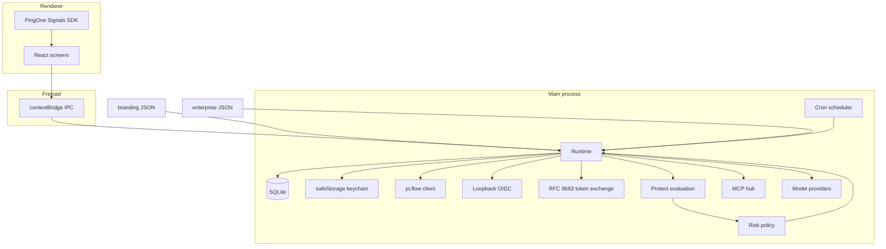

# Enterprise agent client

A white-label desktop AI agent. The product name, agent name, logo, colors, and default persona all come from a branding file. Nothing in the application source assumes a particular brand.

The sample theme in `branding/default.json` names the app and the agent **Pingy**. That name is an example only. Replace the branding file to ship the client under another name.

## What this repository contains

This is the foundation: a runnable Electron app with PingOne sign-in (including a mock mode), token exchange, PingOne Protect risk policy, an MCP client with tool approvals, single-agent chat, and the data model plus screens for instruction layers, group rooms, routines, and cron. Later work is listed under [Follow-up issues](#follow-up-issues).

## Stack

| Piece | Choice |
| --- | --- |
| Shell | Electron 44, React 19, TypeScript, Vite via electron-vite |
| MCP | `@modelcontextprotocol/client` 2.x (stdio, Streamable HTTP, SSE fallback) |
| Local data | `node:sqlite` (`DatabaseSync`) in the user-data directory |
| Secrets | Electron `safeStorage` (macOS Keychain, Windows DPAPI, Linux libsecret). Encrypted blobs sit in SQLite. If encryption is unavailable, secrets stay in memory for that process and are not written to disk. |
| Platforms | The same code path targets macOS, Windows, and Linux. CI runs on Linux. Installers and code signing are not in this version. |

Alternatives considered:

- **Electron rather than Tauri.** The official MCP client and `safeStorage` are Node APIs. A Tauri shell would mean a second MCP stack and a separate keychain crate.
- **`node:sqlite` rather than `better-sqlite3`.** Node 22 includes `DatabaseSync`, so the app does not need a native rebuild per Electron ABI. The module is still marked experimental by Node.
- **`safeStorage` rather than `keytar`.** `keytar` is unmaintained. `safeStorage` is the Electron-supported OS keychain.
- **MCP client package v2 rather than `@modelcontextprotocol/sdk` v1.** v2 is the current client line. The sample stdio server speaks the legacy `initialize` handshake, which is the client's default.

## Architecture



Sign-in, in order:

1. The login screen collects a username and password and, in real PingOne mode, Protect Signals data.
2. Preferred login is redirectionless **pi.flow** (`response_mode=pi.flow`) with authorization code and PKCE (S256). The system browser plus a `127.0.0.1` loopback redirect is a configurable fallback.
3. Protect runs a risk evaluation before the session is stored. Policy maps the level and reason codes to one action: allow, step-up MFA, restrict tools, read-only, or block. The most restrictive matching action wins.
4. A blocked result never stores a session. Step-up restarts the flow with `acr_values` when that value is configured. Mock mode accepts any 6-digit one-time code for the new-device scenario.
5. The user token is stored in the keychain. If a refresh token exists, expiry refreshes it. Otherwise the user signs in again.
6. Each configured audience is exchanged (RFC 8693) and cached until expiry. MCP connections receive that token: HTTP and SSE via the client auth provider, stdio via `MCP_ACCESS_TOKEN`.

The agent is risk-aware. The composed system prompt is enterprise policy, then persona, then the user layer, then optional room instructions, then the current risk context (level, reasons, and the behaviour the policy requires).

## Setup

Requirements: Node.js 22.13 or newer.

```bash
npm install
npm run dev
```

Mock mode is the committed example, so `npm run dev` signs in locally and does not call PingOne. Any non-empty password is accepted. On the login screen, choose a risk scenario: low, new device, anomalous location, impossible travel, or bot.

### If dev reports "Electron uninstall"

Electron 44's npm package does not download the desktop binary from a `postinstall` script. `electron-vite` then reads `node_modules/electron/path.txt` and throws `Error: Electron uninstall` when that file was never written. A fresh `npm install` on macOS (and on Windows or Linux) hits this before the window opens. The message means the desktop binary was never downloaded.

`postinstall`, `predev`, and the `dev` script itself run `scripts/ensure-electron.mjs`. When the binary for the current OS is missing, that script runs `node node_modules/electron/install.js`, which writes `path.txt` (`Electron.app/Contents/MacOS/Electron` on macOS, `electron.exe` on Windows, `electron` on Linux). `npm install && npm run dev` therefore downloads Electron before `electron-vite` starts.

`npm install --ignore-scripts`, or `ignore-scripts=true` in your npm config, skips `postinstall` and `predev`. The `dev` script still runs the check, because npm executes the script you named even when it skips lifecycle hooks. If you start `electron-vite` directly, run the installer yourself:

```bash
node node_modules/electron/install.js
npm run dev
```

The zip comes from the Electron GitHub releases. Behind a proxy, set `ELECTRON_MIRROR` to a mirror of those releases. `ELECTRON_SKIP_BINARY_DOWNLOAD=1` skips the check on purpose; unset it and run the installer above when you want the app to launch.

To point the app at a real tenant, copy the example config and env file. Do not commit either copy.

```bash
cp config/enterprise.example.json config/enterprise.json
cp .env.example .env
```

In `config/enterprise.json` set `tenant.mode` to `pingone` and fill the hosts, environment id, and public client id. Put the worker client id and secret in `.env` (`PINGONE_WORKER_CLIENT_ID`, `PINGONE_WORKER_CLIENT_SECRET`). The settings screen can also store the worker secret in the OS keychain. Config parsing rejects secret-looking keys so a client secret cannot be committed inside JSON.

`BRANDING_PATH` overrides the branding file. `ENTERPRISE_CONFIG` overrides the enterprise file. The defaults are `branding/default.json` and, when present, `config/enterprise.json`, otherwise the example.

In a container where Chromium's sandbox cannot start, launch with both variables. `ELECTRON_DISABLE_SANDBOX` is read before the process starts; `AGENT_DISABLE_SANDBOX` also turns off GPU acceleration and `/dev/shm` usage.

```bash
ELECTRON_DISABLE_SANDBOX=1 AGENT_DISABLE_SANDBOX=1 npm run dev
```

Do not use those switches on a desktop you do not control. The sandboxed preload is built as CommonJS (`out/preload/index.cjs`) so it loads when `package.json` has `"type": "module"`.

### Scripts

| Script | Purpose |
| --- | --- |
| `npm run dev` | Vite dev server plus Electron |
| `npm run build` | Production bundle in `out/` |
| `npm run preview` | Run the production bundle |
| `npm run typecheck` | `tsc` for the main and renderer projects |
| `npm run lint` | ESLint |
| `npm test` | Vitest |

### Try the sample tools

1. Sign in with any username and a non-empty password. Leave the scenario on low.
2. Open **Tools**, connect **Local echo**. It runs `node examples/echo-mcp-server.mjs`.
3. In chat, send `echo hello`. Approve the tool call once. The transcript shows the tool card and the model's follow-up.
4. Sign out, choose **New device**, sign in again, and enter any 6-digit code. The session shows step-up. **Impossible travel** and **Bot** block sign-in.

## Branding

`branding/default.json`:

| Field | Role |
| --- | --- |
| `appName`, `agentName`, `tagline`, `about` | Required. The window title and login copy use these strings. |
| `logo` | SVG or image path next to the JSON file. Omitted logos fall back to a monogram of the app name. |
| `colors` | Required palette. Keys become CSS variables (`sidebarText` → `--sidebar-text`). |
| `persona` | Default instruction fields: `persona`, `communicationStyle`, `autonomy`, `safety`, `untrustedContent`. `{{appName}}` and `{{agentName}}` are filled when the prompt is composed. |

A missing `appName` throws. The app does not substitute a built-in name.

## Enterprise config

`config/enterprise.example.json` holds the tenant, token-exchange audiences, Protect policy, locked enterprise instructions, agents, rooms, MCP servers, routines, and provider defaults.

Risk actions, from least to most restrictive: `allow`, `step_up_mfa`, `restrict_tools`, `read_only`, `block`. A reason override replaces the level default when it is more restrictive. `restrict_tools` hides "always allow". `read_only` denies tools that are not marked `readOnlyHint`. `block` denies every tool and does not create a session. Step-up gates entry; after MFA the session stays active and step-up does not also restrict tools.

Provider keys (`OPENAI_API_KEY`, `ANTHROPIC_API_KEY`, `GENERIC_PROVIDER_API_KEY`) are read from the environment into the keychain if that account is empty. The settings screen never displays a stored key. Leaving the field blank keeps the stored value.

The chat provider in this version is the global settings choice. Per-agent provider values are stored and are not yet what `speak()` uses.

## PingOne admin configuration

Use two applications in the same environment. A public PKCE application cannot also be the confidential token-exchange client.

### 1. Native or single-page application (interactive login)

| Setting | Value |
| --- | --- |
| Application type | Native (or SPA) |
| Grant types | Authorization Code |
| PKCE | Required, S256 |
| Token endpoint authentication | `NONE` |
| Redirect URI | `http://127.0.0.1:53147/callback` (must match `tenant.redirectUri`) |
| Scopes | `openid`, `profile`, `email` |
| Response modes | `pi.flow` for the in-app login, and `query` for the system-browser fallback |
| Sign-on policy | Username/password, or identifier first followed by a PingOne password. Add an MFA step if you want real step-up. External identity providers, FIDO2, and push still use the system browser. |

Put the environment id and this application's client id in `tenant`. Set `tenant.authHost` and `tenant.apiHost` for the region (`https://auth.pingone.com` and `https://api.pingone.com`, or the `.eu`, `.ca`, `.asia`, or `.com.au` hosts). `tenant.region` is a label for operators; the hosts are what the client calls.

`tenant.login.preferred`: `pi.flow` or `system-browser`. `allowSystemBrowserFallback` shows the browser button next to pi.flow. `stepUpAcrValues` is sent as `acr_values` when policy asks for step-up and the first flow did not challenge the user. If that second flow still has no MFA challenge, sign-in stops and the message tells an admin to fix the sign-on policy. A locally typed code is treated as MFA only in mock mode.

pi.flow actions are `POST`ed to the `_links` href for that action. When the status requires the action and the href did not parse, the client posts to `{authHost}/{envId}/flows/{flowId}`. It reads `status` and `_links` before choosing an action, and it does not post `usernamePassword.check` on an identifier step.

- `USERNAME_PASSWORD_REQUIRED` and `PASSWORD_REQUIRED` post `{ "username", "password" }` as `application/vnd.pingidentity.usernamePassword.check+json`.
- Identifier first (`SIGN_ON_REQUIRED`, or the same step when the status is `IDENTIFIER_REQUIRED`) posts `{ "username" }` as `application/vnd.pingidentity.user.lookup+json`. If the next status is `PASSWORD_REQUIRED` (or still offers `usernamePassword.check`), the password is posted with the username/password media type. If the next status is OTP, device selection, or an external provider, the password is not posted and that step is shown instead.
- `OTP_REQUIRED` posts `application/vnd.pingidentity.otp.check+json`.
- `DEVICE_SELECTION_REQUIRED` posts `application/vnd.pingidentity.device.select+json`.

`COMPLETED` (and `COMPLETED_ACCEPTED` when it carries a code) is read from `authorizeResponse.code` or from the resume URL. The code is exchanged at `{authHost}/{envId}/as/token` with `grant_type=authorization_code`, the PKCE verifier, and no client secret.

### 2. Worker application (token exchange and Protect)

| Setting | Value |
| --- | --- |
| Application type | Worker |
| Grant types | Token Exchange, Client Credentials |
| Token endpoint authentication | `CLIENT_SECRET_BASIC` |
| Resource grants | Each custom resource the desktop should call |

Store the client id and secret in the environment or the keychain, not in git. Client credentials mint the worker token used as the bearer on Protect. Token exchange uses the same worker identity as the confidential client, with the user's access token as the subject.

### 3. Custom resources (audiences)

For each MCP server or downstream API that should receive an exchanged token:

- Create a custom resource. The audience URL must not contain `pingone` or `pingidentity`.
- Grant the worker application that resource and the scopes the server expects.
- Add an entry under `tokenExchange.audiences` with `audience`, `scope`, and the `serverId` of the MCP server that should receive the token.

The exchange request is `grant_type=urn:ietf:params:oauth:grant-type:token-exchange`, with `subject_token` and `subject_token_type` / `requested_token_type` set to `urn:ietf:params:oauth:token-type:access_token`, plus `audience` and `scope`. Tokens are cached in the keychain until shortly before `expires_in`.

### 4. Protect

| Setting | Value |
| --- | --- |
| Protect | Enabled on the environment |
| Risk policy | Include New Device, User Location Anomaly, Bot Detection, Anonymous Network, and IP Reputation |
| Impossible travel | Read from the evaluation details flag `impossibleTravel` |
| Worker role | A custom role that can create and update risk evaluations. Do not grant Environment Admin for this. |

The client `POST`s `{apiHost}/v1/environments/{envId}/riskEvaluations`. The event includes `ip`, `user.id`, `user.type` (`EXTERNAL` by default), and `sdk.signals.data` from the Signals SDK when the login mode is `pingone`. Mock mode does not load the SDK and does not call PingOne.

IP handling: the example config sets `protect.resolvePublicIp` to `true`. The main process calls `https://api.ipify.org` with a 2 second timeout, then `https://checkip.amazonaws.com` if that lookup fails. `protect.reportedIp`, when set, is sent instead and no lookup runs. If no address is available, the client still `POST`s the risk evaluation without `ip`. When PingOne accepts that event, its level is used. When PingOne rejects it, sign-in continues at level `UNKNOWN` and the action configured for that level. The example maps `UNKNOWN` to `restrict_tools`: the session is created, every tool call needs a fresh approval, and the system prompt tells the agent that Protect did not score the sign-in. A Protect error after an IP was sent still stops sign-in. After the session is allowed, the client `PUT`s the evaluation with `completionStatus` `SUCCESS`. A block or a failed sign-in sends `FAILED`.

Map levels and reason codes in `protect.policy`. Levels are `LOW`, `MEDIUM`, `HIGH`, and `UNKNOWN` (default `restrict_tools` when the key is omitted). Reason codes the policy understands: `NEW_DEVICE`, `ANOMALOUS_LOCATION`, `IMPOSSIBLE_TRAVEL`, `BOT`, `ANONYMOUS_NETWORK`. Unknown predictor output is still shown to the user and the agent.

The Signals SDK is loaded only for `tenant.mode: pingone`. The renderer content-security policy allows the regional PingOne app, auth, and API hosts plus `api.ipify.org`.

## What works in this version

- Branding file, sample Pingy theme, and a test that the sample agent name is not hardcoded under `src/`.
- App shell: login, chat, rooms, routines, tools, instructions, settings.
- Mock PingOne sign-in with the five risk scenarios, plus the real pi.flow and loopback clients.
- Keychain session storage, refresh when a refresh token exists, re-auth otherwise.
- RFC 8693 exchange and audience cache, injected into MCP connections.
- Protect evaluation client, reason extraction, policy engine, and risk text in the system prompt.
- MCP stdio, Streamable HTTP, and SSE fallback. Server management UI. Per-tool allow once / always / deny. Tool cards in the transcript.
- Streaming chat, markdown, history, attachments, and providers: mock (default), OpenAI-compatible, Anthropic, and a generic HTTP provider.
- Layered instructions. The enterprise layer is read-only in the UI. Persona resets to the branding file. The user layer is editable.
- Group rooms with a sequential reply from each member, room instructions, routines, and cron while the window is open, with run history.
- Unit tests, lint, typecheck, and a GitHub Actions workflow.

## What is stubbed

- OS installers, auto-update, and code signing.
- pi.flow statuses this UI does not complete: FIDO2 assertion, push confirmation, magic link, account recovery, and external identity-provider redirects. Those stop with a message that names the flow status and points at the system browser. Identifier-first policies are handled.
- Continuous Protect re-evaluation during a session, and richer feedback than the completion-status update.
- Anthropic and generic-provider extras: extended thinking, prompt caching, and full vision parity. Basic streaming and image blocks on the Anthropic path are implemented.
- Group chat fan-out, @mentions, and debate. Replies are sequential.
- Routines while the app is closed.
- Conversation search, export, rename, and delete.
- MCP resources, prompts, sampling, and elicitation. Remote MCP OAuth is not implemented; HTTP servers get the exchanged PingOne token only.
- Tool-result streaming.
- Encryption of conversation rows at rest. Tokens are encrypted; message text is not.
- A policy editor. Policy is JSON.
- Per-agent provider selection in the UI. The global provider wins.
- Localization, automated UI tests, PingOne logout/revoke, and a deep link in place of the fixed loopback port.
- JWKS verification of ID tokens. The payload is decoded and the signature is not checked.
- Composing step-up and restrict-tools on the same result. One action is chosen.
- ID-token `sub` is used as the Protect user id when the flow did not return a user. Browser login cannot know that MFA ran, so policy can still demand step-up afterward.

## Follow-up issues

1. Package and sign macOS, Windows, and Linux builds.
2. Finish the remaining pi.flow statuses and PingOne logout plus refresh-token revoke.
3. Re-evaluate Protect on a timer and on sensitive tool calls, and send predictor feedback beyond completion status.
4. Verify ID tokens against the environment JWKS.
5. Let step-up and a tool restriction apply together when policy asks for both.
6. Use each agent's own provider, and surface that choice in the UI.
7. Run group turns in parallel, with @mentions.
8. Run due routines after the app launches, and document a signed-in background helper for when it is closed.
9. Encrypt conversation content at rest with the same keychain key.
10. MCP resources, prompts, and sampling, plus remote MCP OAuth distinct from PingOne token exchange.
11. Conversation search, rename, delete, and export.
12. Replace the fixed loopback port with a registered deep link.
13. Add a UI test pass for login scenarios, approval, and rooms.
14. Admin UI for risk policy, or a signed remote policy document.
15. Localization.

## Development notes

- Tests use an in-memory database and a renamed branding object so they do not depend on the sample theme's name.
- `examples/echo-mcp-server.mjs` is a newline-delimited JSON-RPC stdio server with one read-only `echo` tool.
- The scheduler checks every 15 seconds. Five-field cron uses the usual rule: when both day-of-month and day-of-week are restricted, a time matches if either field matches. A routine fires at most once per minute, and only while the process is running. The sample weekday 09:00 routine ships disabled.
- CI is `.github/workflows/ci.yml`: Node 22, `npm ci`, lint, typecheck, test, and build, on pushes to `main`, `develop`, and `cursor/**`, and on pull requests.
